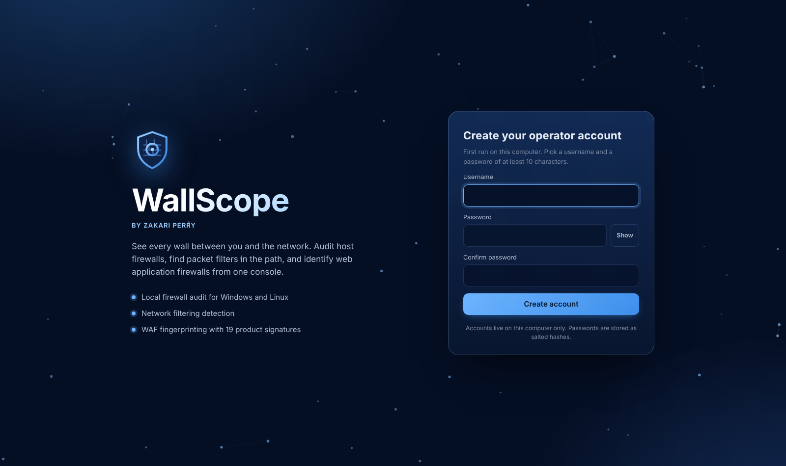
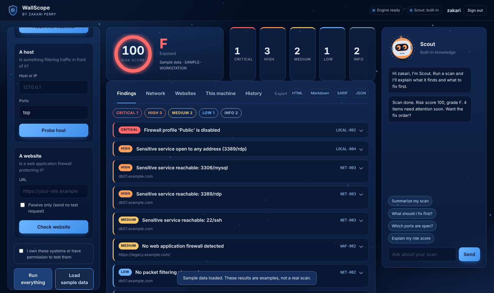

# WallScope

**By ZaKari Perry**

WallScope tells you what firewalls are actually standing between a machine and the network. Point it at your own computer, a host, or a website and it answers three questions:

- **Is this machine's firewall on, and are any of its rules risky?**
- **Is something filtering traffic in front of that host?**
- **Is that website sitting behind a web application firewall, and which one?**

It ships with a dashboard you sign in to, a risk score, exportable reports, and Scout, an animated assistant that explains the results and tells you what to fix first.





*The dashboard above is showing the bundled sample data, not a real scan.*

## Quick start

You need the [.NET 8 SDK](https://dotnet.microsoft.com/download/dotnet/8.0) and [Python 3.11+](https://www.python.org/downloads/). Nothing else: the Python side has no dependencies, and the dashboard is already compiled.

**Windows (PowerShell)**

```powershell
git clone https://github.com/ZakariDev27/wallscope.git
cd wallscope
.\run.ps1
```

**Linux**

```bash
git clone https://github.com/ZakariDev27/wallscope.git
cd wallscope
./run.sh
```

Then open **http://127.0.0.1:8787** in your browser.

The first time, WallScope asks you to create an operator account. After that it's a normal sign-in page. Once you're in, press **Audit this machine** for a real scan of your own computer, or **Load sample data** to look around first.

> For the fullest local audit, start it from an elevated terminal (Run as administrator on Windows, `sudo` on Linux). Without that, WallScope still runs and simply tells you which details it couldn't read.

## What's inside

Three languages, each doing the job it's best at:

| Layer | Language | What it does |
| --- | --- | --- |
| Detection engine | C# (.NET 8) | The scanning itself: reads firewall state, probes ports, fingerprints WAFs. Outputs JSON. |
| Platform layer | Python | Runs the engine, scores risk, checks policy, tracks drift, renders reports, serves the dashboard, powers Scout. |
| Dashboard | TypeScript | The sign-in page, the interactive console, and Scout's animation. |

```
src/FirewallDetector.Core/     engine library (local audit, network probe, WAF detection)
src/FirewallDetector.Cli/      the `wallscope` command-line tool
tests/FirewallDetector.Tests/  engine tests (xUnit)
python/wallscope/              platform layer + dashboard server
python/tests/                  platform tests (pytest)
dashboard/src/                 TypeScript source for the dashboard
examples/policy.toml           sample policy file
```

## The three detectors

### 1. Local firewall audit

Reads the firewall on the machine WallScope runs on.

- **Windows:** Windows Defender Firewall profiles (Domain / Private / Public), every enabled inbound allow rule, and any third-party firewall registered with Windows Security Center.
- **Linux:** ufw, firewalld, nftables and iptables.

It flags a firewall that's off, a disabled profile, a default policy of "allow", rules that open sensitive services (RDP, SMB, databases, Telnet and more) to any address, and rules that allow every port from anywhere.

### 2. Network filtering detection

Opens ordinary TCP connections to a list of ports and watches *how* each one fails. An open port answers, a closed port sends a reset, and a filtered port says nothing at all. A host that resets some ports while others go silent has a packet filter in front of it. No raw sockets, so no special privileges needed.

### 3. WAF detection

Fetches a page normally, then fetches it again with a few harmless marker strings that every mainstream WAF rule set blocks, and compares the answers. Response headers, cookies and block pages are matched against signatures for 19 products, including Cloudflare, AWS WAF, Akamai, Imperva, F5, Azure, Fastly, ModSecurity and Sucuri. The markers are inert: they go in an unused query parameter and exploit nothing. Use **Passive only** to skip the test request entirely.

## The dashboard

- **Buttons for everything:** audit this machine, probe a host, check a website, or run all three.
- **Risk score** from 0 to 100 with a letter grade, plus a count by severity.
- **Findings** you can filter and expand, each with a plain-language fix.
- **Network view** with a tile per port, **Websites view** with confidence meters, and a **This machine** view with profiles and rules.
- **History and compare:** every scan is saved; pick an older one to see what changed.
- **Export** any scan as HTML, Markdown, SARIF or JSON.

### Scout, the assistant

Scout lives in the right-hand panel. It floats, blinks, follows your pointer with its eyes and head, changes expression with how the scan went, and talks while it writes.

It has two brains:

- **Built-in (default).** Answers from your scan with no internet connection and no API key. Ask for a summary, the fix order, open ports, WAF results, or any finding by ID ("Explain LOCAL-004").
- **Claude (optional).** Set `ANTHROPIC_API_KEY` before starting the dashboard and Scout sends your question, with the scan as context, to the Anthropic API for free-form answers. If the call fails, Scout falls back to the built-in brain. Set `WALLSCOPE_AI_MODEL` to choose the model.

## Command line

The engine works on its own:

```bash
dotnet build -c Release
alias wallscope="dotnet src/FirewallDetector.Cli/bin/Release/net8.0/wallscope.dll"

wallscope local
wallscope probe --targets 127.0.0.1 --ports top
wallscope waf --urls https://your-site.example --authorized
wallscope scan --local --targets 10.0.0.5 --urls https://your-site.example --authorized --output report.json --fail-on high
```

The Python layer adds scoring, policy, drift and reports. Run these from the `python` folder, or `pip install -e python` to get the `wallscope-hub` command anywhere:

```bash
python -m wallscope scan --local --out reports/today.json
python -m wallscope score reports/today.json
python -m wallscope report reports/today.json --format html --out today.html
python -m wallscope check reports/today.json --policy ../examples/policy.toml   # exit code 2 on violation
python -m wallscope diff reports/yesterday.json reports/today.json --fail-on-change
python -m wallscope serve --port 8787
```

`check` and `diff` are built for pipelines: fail a build when the risk score climbs, a forbidden port opens, or a WAF disappears.

## Use it responsibly

Only scan systems you own or have written permission to test. WallScope enforces this at the edges: anything that isn't the local machine needs the `--authorized` flag on the command line or the permission checkbox in the dashboard. Scanning other people's systems without permission can be illegal where you live.

## Security of the dashboard

- Listens on `127.0.0.1` only, unless you pass `--host`.
- Passwords are stored as salted PBKDF2-SHA256 hashes in `~/.wallscope/users.json`, never in the clear.
- Sign-in attempts are rate limited, sessions use `HttpOnly` / `SameSite=Strict` cookies, and a strict Content-Security-Policy is set.
- Everything typed into the dashboard is validated before it reaches the engine, and the engine is never invoked through a shell.

There is no TLS built in. If you expose the dashboard beyond your own machine, put it behind a reverse proxy that provides HTTPS.

## Development

```bash
dotnet test                              # engine tests
cd python && pip install -e ".[dev]" && pytest
cd dashboard && npm ci && npm run build  # recompiles TypeScript into python/wallscope/web
```

CI runs all three on every push, and builds and tests the engine on both Windows and Linux.

## Good to know

- Rules reached through jumps into other nftables/iptables chains are not expanded, so on Linux the rule list can be shorter than the real ruleset. The on/off state and default policy are still accurate.
- Network results describe what is reachable *from where you ran the scan*. Run it from outside your network to see what the internet sees.
- A WAF in monitor-only mode looks the same as no blocking; WallScope reports that case separately when it can fingerprint the product.

## License

MIT. Copyright (c) 2026 ZaKari Perry.
